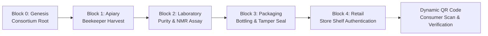

# HoneyChain Architecture & Technical Specification

## 1. Executive Overview

HoneyChain is an application-level, cryptographic supply-chain provenance platform engineered to combat honey adulteration and counterfeit labeling. The platform uses a 5-block cryptographic lifecycle built with Python, Flask, SQLite, and SHA-256 Proof-of-Work (PoW) hashing to ensure tamper-evident traceability from apiary harvest to retail shelves.

---

## 2. Cryptographic Proof-of-Work Ledger Architecture

Each block in the ledger contains:
* `index` (Integer): Zero-based sequential height (`0, 1, 2, ...`).
* `timestamp` (UTC ISO String): Exact UTC timestamp of block mining.
* `block_type` (String): Identifies the lifecycle stage.
* `data` (JSON Object): Payload storing immutable stage telemetry.
* `previous_hash` (64-char Hex): Cryptographic SHA-256 hash of the parent block (`Block 0` uses 64 zeros).
* `nonce` (Integer): Proof-of-Work counter incremented during mining.
* `hash` (64-char Hex): Resulting SHA-256 hash satisfying the difficulty target (`00...`).

### Cryptographic Hashing Formula
$$\text{Payload} = \text{index} + \text{timestamp} + \text{block\_type} + \text{json.dumps(data, sort\_keys=True)} + \text{previous\_hash} + \text{nonce}$$
$$\text{Block Hash} = \text{SHA-256}(\text{Payload})$$

### Mining Condition (Difficulty = 2)
The miner increments `nonce` until:
$$\text{Block Hash} \text{ begins with } \text{"00"}$$

---

## 3. Database Schema (`instance/honeychain.db`)

The SQLite persistence layer comprises 13 synchronized relational tables:

1. **`batches`**: Primary entity storing current batch status, harvest metadata, lab assay scores, packaging specs, and retailer assignments.
2. **`blockchain_blocks`**: Persistent store of mined cryptographic blocks (`index`, `type`, `timestamp`, `data_json`, `previous_hash`, `hash`, `nonce`).
3. **`beekeepers`**: Registry of certified beekeepers, apiary coordinates, active hive counts, and floral varieties.
4. **`laboratories`**: Accredited testing laboratory registry with license numbers and signing key IDs.
5. **`packers`**: Certified bottling plants, packaging supervisor records, and facility certifications.
6. **`sellers`**: Authorized retail stores, boutiques, and shelf inventory.
7. **`stage_updates`**: Granular transaction log tracking every lifecycle change.
8. **`users`**: Role-based access control accounts (`admin`, `beekeeper`, `lab`, `packager`, `seller`, `consumer`).
9. **`orders`**: Consumer and wholesale retail purchase orders.
10. **`feedback_reports`**: Consumer reviews and authenticity feedback.
11. **`notifications`**: System alerts, mining logs, and audit notifications.
12. **`settings`**: Dynamic configuration (`consortium_name`, `blockchain_difficulty`, `currency`, `qr_resolution`).
13. **`admin_login_history`**: Audit log recording administrative access events.

---

## 4. Security & Threat Modeling

* **Tamper Evident**: If any record in SQLite or the block ledger is modified after mining, recalculating `current.calculate_hash()` immediately fails the verification check (`honey_blockchain.is_chain_valid()`).
* **Password Hashing**: Stored passwords use PBKDF2/SHA-256 with random cryptographic salts via `werkzeug.security`.
* **Session Protection**: Cookies are configured with `HttpOnly`, `SameSite=Lax`, and `Secure` flags in production.
* **Input Sanitization**: Database operations use parameterized queries (`cursor.execute(..., (?))`) preventing SQL injection.

