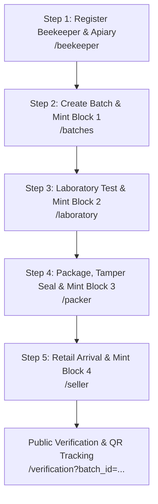

# HoneyChain User & Operational Guide

## 1. Quick Start

### Step 1: Start the Server
```powershell
python app.py
```
* **Local Machine Access:** `http://127.0.0.1:5000`
* **Local Network / Smartphone Wi-Fi Access:** `http://<YOUR_LAN_IP>:5000`

### Step 2: System Login Credentials
| Role | Username | Password | Access Scope |
|---|---|---|---|
| **Consortium Admin** | `admin` | `admin123` | Full administrative control, settings, audit, reports |
| **Apiary Beekeeper** | `beekeeper` | `bee123` | Beekeeper management & harvest batch registration |
| **Lab Specialist** | `lab` | `lab123` | Laboratory quality assays & digital signatures |
| **Packaging Supervisor** | `packager` | `pack123` | Bottling records, tamper seal ID anchoring |
| **Retail Store Manager** | `seller` | `sell123` | Retail arrival records, shelf authentication |
| **Public Consumer** | `consumer` | `consumer123` | Jar QR code verification & complete provenance tracing |

---

## 2. 5-Step Provenance Lifecycle Workflow



### Step 1: Register Beekeeper & Apiary
1. Navigate to **Beekeeper Management** (`/beekeeper`).
2. Input the Beekeeper Full Name, Apiary Name, Location, Hive Count, and Varieties.
3. Click **Register & Proceed to Step 2**.

### Step 2: Honey Batch Management (Mints Block 1)
1. Navigate to **Honey Batch Management** (`/batches`).
2. Enter the Product Label Name, Floral Botanical Source, Producing Apiary, and Harvest Quantity.
3. Click **Mint Block 1 & Proceed to Step 3**.
4. The system automatically mines Block 1 with Proof-of-Work and generates a unique QR code in `static/qrcodes/`.

### Step 3: Laboratory Quality Testing (Mints Block 2)
1. Navigate to **Laboratory Testing** (`/laboratory`).
2. Select your newly minted batch from the dropdown.
3. Fill in Accredited Laboratory Name, Chemist Name, Certificate Number, Purity Score (e.g., 99.8%), and Moisture Content (e.g., 16.4%).
4. Click **Mint Block 2 & Proceed to Step 4**.

### Step 4: Packaging & Tamper Seal (Mints Block 3)
1. Navigate to **Packer Management** (`/packer`).
2. Select the tested batch.
3. Fill in Bottling Facility Name, Jar Format, Tamper Seal ID, and Production Lot Number.
4. Click **Mint Block 3 & Proceed to Step 5**.

### Step 5: Retail Shelf Arrival (Mints Block 4)
1. Navigate to **Seller Management** (`/seller`).
2. Select the packaged batch.
3. Fill in Authorized Retailer Name, Store Physical Location, Retail License, and Price.
4. Click **Mint Block 4 & Authenticate On Shelf**.

---

## 3. Verifying & Exporting

* **Cryptographic Verification**: Visit `/blockchain` and click **Verify Cryptographic Chain Integrity**.
* **Printable QR Code**: Visit `/qr-generator?batch_id=<YOUR_BATCH>` to preview and download high-resolution QR jar labels.
* **Audit PDF Certificate**: Click the PDF icon on the Reports page or visit `/batch/<batch_id>/pdf` to download an official provenance certificate.
* **Exporting Data**: Download CSV or JSON ledger exports from `/reports`.

